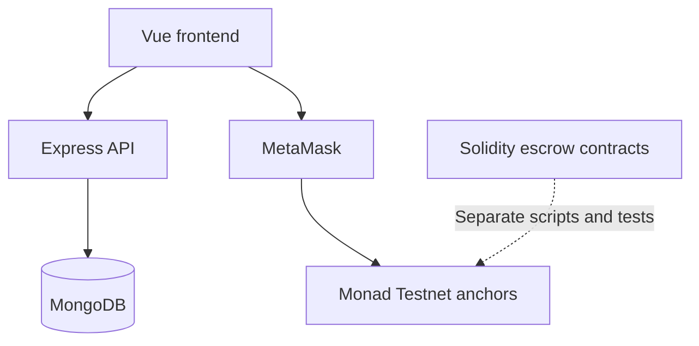

<div align="center">

# MONOSFER

**A courier marketplace exploring delivery coordination and escrow on Monad.**

Vue 3 · TypeScript · Express · MongoDB · Solidity · Foundry

**Hackathon prototype · Monad Testnet · Turkish application interface**

🏆 **1st place · BuilderMare Kayseri Monad Blitz Hackathon**

[Quick start](#quick-start) · [Architecture](#architecture) · [Smart contracts](contracts/README.md) · [Security](SECURITY.md)

</div>

---

MONOSFER connects senders and couriers through delivery requests, competitive bids, pickup confirmation, recipient delivery codes, and courier ratings. The repository combines a working web/API prototype with two smart-contract implementations for exploring escrow and reputation.

> **Current scope:** the web demo records delivery state in MongoDB and submits zero-value self-transactions on Monad Testnet as transaction anchors. Its payment screen does **not** deposit funds into an escrow contract. The Solidity escrow implementations are separate workspaces with their own tests and deployment scripts. Use disposable test accounts and synthetic data.

## What you can explore

| Area | Included in the repository |
| --- | --- |
| Delivery marketplace | Create requests with pickup/dropoff details, urgency, budget, deadline, and recipient information |
| Courier bidding | Submit bids, compare couriers, and select a delivery partner |
| Delivery lifecycle | Track pickup, in-transit, completion, and recipient-code confirmation |
| Courier discovery | Courier directory, map views, ratings, and leaderboard statistics |
| Wallet experience | MetaMask connection, testnet switching, wallet balance, and transaction links |
| Smart contracts | Native MON escrow MVP plus a modular token, escrow, leaderboard, rewards, and badge system |

## Architecture



The API owns the web prototype's delivery records, bids, profiles, and statistics. The wallet submits the demo transactions. Contract event ingestion and contract-backed web payments remain integration work.

| Directory | Responsibility |
| --- | --- |
| [frontend/](frontend/) | Vue 3, Vite, TypeScript, Pinia, Vue Router, and Tailwind CSS |
| [backend/](backend/) | Express 5 API, Mongoose models, JWT middleware, and Node.js tests |
| [contracts/](contracts/) | Foundry workspace, Solidity contracts, deployment scripts, and contract tests |
| [scripts/](scripts/) | Deployment record helpers, testnet deployment, and demo seed tooling |
| [deploy/](deploy/) | Existing Nginx and server deployment examples; adapt to your infrastructure |
| [.github/workflows/deploy.yml](.github/workflows/deploy.yml) | Optional SSH deployment, disabled until explicitly enabled |

## Quick start

### Prerequisites

- Node.js **22.12+** on the 22.x line, or a newer compatible release; npm.
- A local MongoDB instance or a database you control.
- MetaMask and a dedicated Monad Testnet wallet for wallet interactions.
- Foundry (`forge`, `cast`, and optionally `anvil`) for the contract workspace.

The commands below use a Bash-compatible shell, such as Git Bash on Windows.

### 1. Install dependencies and create local configuration

```bash
git clone https://github.com/bilalabic/monosfer.git
cd monosfer

npm ci --prefix backend
npm ci --prefix frontend

cp backend/.env.example backend/.env
cp frontend/.env.example frontend/.env
cp contracts/.env.example contracts/.env
```

Generate a signing secret locally:

```bash
node -e "console.log(require('node:crypto').randomBytes(32).toString('hex'))"
```

Paste the result into `JWT_SECRET` in `backend/.env`. Configure your MongoDB connection there. Keep the generated value private.

| File | Main settings |
| --- | --- |
| `backend/.env` | Database URI/name, JWT signing secret, API host/port, and frontend origin |
| `frontend/.env` | Local API URL and optional public contract addresses |
| `contracts/.env` | Dedicated testnet deployer key and RPC URL; only needed for deployment |

**All `VITE_*` variables are public browser configuration.** Database credentials, JWT secrets, wallet private keys, and privileged provider keys belong exclusively in server-side or deployment configuration.

### 2. Start the API

Ensure MongoDB is running, then open a terminal:

```bash
npm run dev --prefix backend
```

Default API: `http://localhost:3001/api`

Health endpoint: `http://localhost:3001/api/health`. This endpoint reports API liveness; it does not verify database readiness.

### 3. Start the frontend

In another terminal:

```bash
npm run dev --prefix frontend
```

Open the local URL printed by Vite, usually `http://localhost:5173`. Keep `FRONTEND_URL` in the backend configuration aligned with that origin.

### 4. Explore the demo

1. Connect a test wallet and create a sender or courier profile.
2. Create a delivery request with synthetic recipient details.
3. Use a second wallet to bid, then select that bid as the sender.
4. Explore the payment, pickup, recipient-code, completion, and rating screens.
5. Inspect transaction anchors in the testnet explorer and delivery state in the API.

Wallet transactions consume testnet gas. The current web flow does not transfer the displayed delivery budget into escrow.

## Smart contracts

The contract workspace offers two separate designs:

| Design | Contracts | Purpose |
| --- | --- | --- |
| Native MON MVP | `Delivera.sol` | Courier stake, requests, bids, delivery confirmation, and ratings in one contract |
| Modular system | `MCRYToken.sol`, `DeliveryEscrow.sol`, `Leaderboard.sol`, `RewardDistributor.sol`, `ReputationBadge.sol` | Token-based escrow with separate reputation and rewards components |

Build and run the Solidity tests:

```bash
cd contracts
forge build
forge test -vv
```

For a deliberate native-MON **testnet deployment**, populate `PRIVATE_KEY` in `contracts/.env`, fund that disposable wallet with testnet MON, return to the repository root, then run:

```bash
npm run deploy:monad-testnet
```

This command broadcasts transactions, writes a local deployment record, and updates `VITE_DELIVERA_ADDRESS` in the ignored frontend environment file. It does not connect the web demo to that contract. The optional modular addresses in `frontend/.env` must come from your own verified deployment.

See [the contract guide](contracts/README.md) for contract flows, parameters, and the modular deployment command. Its handoff sections include planned integration work.

## Validation commands

```bash
# Backend service and HTTP tests
npm test --prefix backend

# Deployment record helper tests
npm run test:deploy

# Frontend type checking and production bundle
npm run build --prefix frontend

# Solidity tests, with Foundry installed
npm run contracts:test
```

Backend tests use mocks rather than a live database. These checks do not replace a wallet-to-contract end-to-end test.

## Deployment

The existing production files contain environment-specific server paths and hostnames. Review `ecosystem.config.cjs`, `deploy/nginx/`, and `deploy/scripts/deploy-production.sh` before using them on your infrastructure.

The SSH workflow runs only when the repository variable `ENABLE_PRODUCTION_DEPLOY` is `true`. Configure `MONAD_HOST`, `MONAD_USER`, and `MONAD_SSH_KEY` as GitHub Actions secrets, with optional `MONAD_SSH_PORT` and `MONAD_PROJECT_DIR`. Never commit their values. A source-code copy does not provision a server or transfer these secrets.

## Current limitations and next work

This is a prototype for development and demonstration. Before a public service launch:

1. **Authentication and data access:** verify wallet ownership on the server with a nonce and signature, enforce delivery data visibility, and protect recipient-code attempts. The current API accepts a supplied wallet address for login without verifying a signature.
2. **Contract integration:** replace transaction anchors with actual escrow calls and verify receipts/events in the API before changing payment or delivery state.

Additional known gaps include the lack of a complete dispute-resolution flow, simulated courier locations in the backend, demo QR rendering, and unaudited smart contracts. The root `npm run deploy` helper still targets a removed `Counter.sol` artifact; use the documented Delivera testnet script instead.

See [SECURITY.md](SECURITY.md) for environment handling, the security review, and remaining hardening steps.

## Recognition

MONOSFER won **1st place at the BuilderMare Kayseri Monad Blitz Hackathon**, hosted at Abdullah Gül University (AGÜ). The team built a transparent courier marketplace on Monad to address high commissions, unfair scoring and weak trust in delivery payments, and received top marks from the jury.

## Team

Developed collaboratively by [Yusuf Arslan](https://github.com/yusufarslan44), [Ahmet Turan Doğan](https://github.com/AhmettDgn), and [Bilal Abiç](https://github.com/bilalabic), as recorded in the Git history. The full commit history of both branches (`main` and `Monosfer-V2`) is included.

## License

No project-level license has been selected. Vendored dependencies, including `forge-std`, retain their own licenses.
